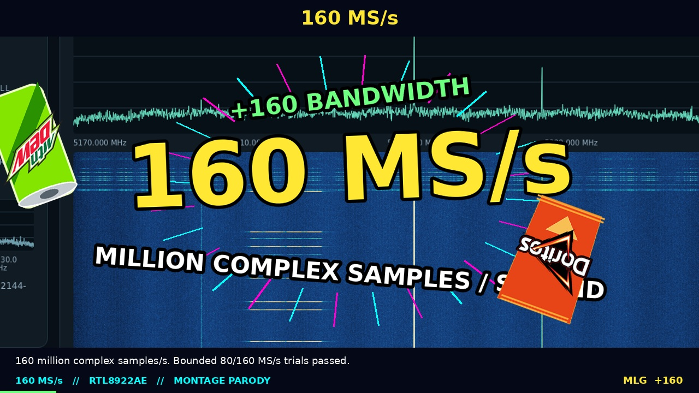

# RTL8922 SDR research

[](https://github.com/plaingca/rtl8922-sdr/actions/workflows/offline.yml)

Experimental raw I/Q reception from a Realtek RTL8922AE Wi-Fi card: patched
Linux driver, SoapySDR plugin, live FFT/waterfall demo and timed ADALM-Pluto
waterfall text and reference tone generation.

### The Spectrum Spectacular

[](docs/media/rtl8922-classic-mlg-160msps.mp4)

[Watch the classic MLG montage parody](docs/media/rtl8922-classic-mlg-160msps.mp4):
160 MS/s waterfalls, eight CRC-checked sections of a 160 MHz Wi-Fi 6 header,
actual meme clips, Suno dubstep, classic drop stings, spinning Dew / Doritos,
quickscopes, bass-synced zooms / hitmarkers and a completely excessive 160 reveal.
No TTS. Sound on.
[Captions, evidence and reproduction](docs/media/README.md).

## Start here

- [Getting started](docs/getting-started.md): setup, offline checks, receiver launch,
  SSH forwarding and troubleshooting.
- [Receive and transmit capabilities](docs/capabilities.md): what has actually
  worked, what remains experimental, and links to measured evidence.
- [Transmit quick start](docs/transmit.md): compile application I/Q without
  hardware, then follow the appropriate bounded lab experiment.
- [Research map](docs/research-map.md): firmware, tuning and waveform investigations.

```sh
make help
make doctor PYTHON=.venv/bin/python
make check PYTHON=.venv/bin/python
make check-distribution
```

These commands never open a radio. Launching the demo is a separate, explicit action.

## Current state

| Path | Demonstrated result | Main limit |
| --- | --- | --- |
| RTL8922 receive | One PATH1 diagnostic I/Q path, CF32/CS16; 20 MS/s free tuning and explicit legacy 40 MS/s mode | Retune gaps; indefinite sample continuity is unqualified |
| RTL8922 PAXI reception | Default continuous 160 MS/s at 5250 MHz; bounded 80/160 MS/s transport and 160 MS/s sample continuity at 2447 MHz | Firmware held; mandatory reload; indefinite continuity and full-band fidelity unqualified |
| Pluto transmit | Timed waterfall text or reference tone in the browser demo | External Pluto hardware, separate from RTL8922 TX |
| RTL8922 experimental transmit | Bounded 200-kHz OFDM from causally compiled 533.333 kS/s I/Q; 2027/2048 exact CRC frames in two runs | Constrained NCO commands, distortion and host refill deadlines; no Soapy TX stream |
| RTL8922 LoRa experiment | Selected presets decoded on Pluto, including 10/10 Short Turbo at 1.625 MHz | SF11/SF12 failures; commercial-node interoperability unqualified |

Free-tuning requested centers are **2312–2382, 2412–2484, 2500–2515 and
4900–7115 MHz**, subject to enabled baseline channels. External RF tone
validation ends at 6 GHz. The browser demo defaults to **160 MS/s at 5250 MHz**, displaying
**5170–5330 MHz**. It runs until explicitly stopped. Receive faults mark a gap,
restore Pluto, reload the isolated driver and reconnect the browser automatically.
The separate [PAXI experiment](docs/highrate-reception.md) has passed 60-second
transport and CF32 application trials at 80/160 MS/s; the default continuous
160 MS/s demo also passed a three-minute run beyond the former counter rollover.
The [sample-continuity follow-up](docs/continuity-pd-findings.md) inhibits active
packet detection and passes a bounded one-second coded-reference check at
160 MS/s / 2447 MHz, with single-sample fault controls at every tested boundary.
Indefinite sample continuity,
raw DAC replay, indefinite arbitrary-I/Q TX and emission masks remain unresolved. Command rate, I/Q input rate and occupied
RF bandwidth are different quantities; see the [capability guide](docs/capabilities.md).

## Contents

- `driver/`: working kernel patch, pinned upstream provenance and setup script.
  Experimental patches are alternatives, **not** patches to stack onto the working driver.
- `SoapyRTL8922.cpp`, `fields.hpp`: SoapySDR receiver and recovered LA fields.
- `live-bridge.cpp`, `live-demo.py`, `live-demo.html`, `pluto_tone.py`: streaming
  bridge, browser demo and bounded reference transmitter. `waterfall_text.py`
  builds the RF text waveform; `tests/` contains hardware-free checks.
- `*-check.cpp`, `*-check.py`, `coded-continuity.py`: hardware validation tools.
  Some older tools retain host paths; inspect before running.
- `tools/`, `Makefile`: local setup diagnostics and hardware-free build/test shortcuts.
- `research/`, `output/`: archived experiments, analysis and small reports.
- `examples/beastmode/`: original host-specific launchers for reference.

## Build on Linux

```sh
git clone --depth 1 https://github.com/plaingca/rtl8922-sdr.git
cd rtl8922-sdr
```

The repository includes demonstration movies and their source assets. GitHub
source archives omit the generated movies; use a Git checkout to watch them.

Dependencies: matching running-kernel headers, GCC/G++, make, git, CMake,
SoapySDR development files, recent `iw`, `pciutils`, NetworkManager,
libiio, single-precision FFTW (`libfftw3-dev`), pkg-config and Python.

```sh
bash driver/prepare-default.sh
make -C vendor/rtw89-paxi-wide -j4
cmake -S . -B build -DCMAKE_BUILD_TYPE=Release
cmake --build build -j4
python3 -m venv .venv
.venv/bin/pip install -r requirements.txt
```

The setup script downloads `morrownr/rtw89` at commit
`8bbbacadf6fa73c3a3195aefbd4b2ec2422ae356`, including upstream firmware,
then builds the separate PAXI profile from the pinned working patch and
`research/streaming/prepare-paxi.py --wide-queue`. It does not install or load modules.
Firmware remains subject to its upstream `LICENCE.rtlwifi_firmware.txt`.

Build against the **same SoapySDR ABI as the application**. The original host
has incompatible `/usr` and `/usr/local` builds; select a matching
`SoapySDR_DIR` and separate build directory when necessary. No system plugin
installation is required if `SOAPY_SDR_PLUGIN_PATH` points at the build.

## Run the demo

The wrapper requires an otherwise unbound RTL8922AE, no loaded `_git` modules,
and absent temporary firmware/NM config paths. It refuses to overwrite these.
Root is needed for debugfs, modules and the worker's SCHED_DEADLINE policy.
The wrapper removes temporary firmware/config and unloads its modules on exit.
It does not automatically unbind a card used for networking.

```sh
sudo env RTL8922_PCI=0000:0d:00.0 \
  RTL8922_IW=/usr/sbin/iw \
  RTL8922_COUNTRY=CA \
  SOAPY_SDR_ROOT="$PWD/build/soapy-root" \
  SOAPY_SDR_PLUGIN_PATH="$PWD/build" \
  "$PWD/.venv/bin/python" run-demo-service.py
```

Use the host's actual country in `RTL8922_COUNTRY`; omitting it retains the
current domain, which is restored on exit. This example matches the original
Canadian host. Recent `iw` with 6-GHz support may be needed for upper bands.

Open **http://127.0.0.1:8732/**. The server listens on loopback only;
forward that port through SSH for a remote receiver. A different local
forwarded port is supported: Host remains restricted to loopback names, while
browser control commands must match that exact local origin. Closing the browser
does not stop reception. Use **Stop demo & release hardware**, or terminate
the launcher.

`RTL8922_DRIVER_DIR` overrides the selected driver directory; `RTL8922_FIRMWARE` overrides
the firmware source. `RTL8922_PLUTO_URI` defaults to `ip:192.168.2.1`.
`RTL8922_DEVICE_ARGS` overrides the bridge's default
`driver=rtl8922,capture_mode=paxi,producer_scheduler=deadline`.
The bridge starts at 5250 MHz and 160 MS/s, with no capture timer. Live tuning now covers enabled 2.4 GHz channel centers and 5 MHz centers
from 5005 to 7115 MHz. Each retune pauses sampling briefly and marks a gap;
the driver stays loaded during retunes. The service supervisor reloads the
isolated driver after a capture fault, preserving the tuned center and recording
the interruption. Stop Demo ends the supervisor and releases the card.
The wrapper releases the card on exit. Plain `driver=rtl8922` also defaults
to 160 MS/s PAXI. Explicit `free_tuning=1` retains the legacy tuning path.

For the previous 40 MS/s demo, prepare/build `vendor/rtw89` with
`driver/prepare.sh`, then add `RTL8922_CAPTURE_MODE=legacy40` to the launch
environment. It selects the working driver and 2422–2462 MHz centers.
Generic low-rate applications can select `driver=rtl8922,capture_mode=legacy`.
Setting `SOAPY_SDR_ROOT` to a private empty path prevents an older installed
plugin from taking precedence over the checkout build.
The plugin accepts `iw=`, `pci=` and `debugfs=` device arguments.
Multi-card operation is unqualified; debugfs discovery takes the first
compatible loaded device.

Pluto opens only when requested and refuses an already active transmitter.
Enter up to 16 characters and press **Transmit / apply** to paint real RF text
on the waterfall. The default message is `RTL8922`, centered at +750 kHz,
using a nominal 1 MHz canvas. The 1.5 MHz close-up makes it readable; the
160 MHz overview shows its place in the full capture. Reference-tone mode,
follow/fixed frequency, offset, gain and a 5–300-second timer remain available.
Each text row uses a small cyclic multitone buffer for about 0.3 seconds; row
changes briefly gate TX. A native 262,144-point FFT targets 240 frames/s; measured FFT and server rates
are shown in the browser. Spectrum frames arrive over one persistent SSE stream,
and the browser batches waterfall rows at its screen refresh rate.
The peak-binned waterfall retains
the narrow carriers. A separate publisher keeps slow display processing from
blocking the hardware reader; skipped display snapshots are counted separately
from receive errors. No synthetic text is painted into the received display.
Timeout, stale RX, Stop TX and normal server exit mute TX and restore saved
settings. A prior broken IIO connection prevented restoration; check TX state
after transport failures.

Offline checks: `python3 -m unittest discover -s tests -v`. The explicit manual
RF check is `research/demo/check_live.py --run-rf-test --report <path>`;
`research/demo/check_backpressure.py --run-capture-test` pauses only the display
server for two seconds with Pluto off. These require the running beastmode demo
and must never be invoked automatically by CI. See
[demo validation](docs/demo40-waterfall.md) for the measured result.

## Continuing development

This standalone snapshot was extracted from the command-center workspace on
2026-10-12. Existing live services were kept on their original paths during
migration. The 40 MS/s demo update moved `rtl8922-live-demo.service` to this
checkout while retaining the original pinned working driver and Pluto Python
environment. The original 20 MS/s launcher remains available as a fallback.
Board filtering and sensitivity outside qualified points remain
uncharacterized. Next targets: channel-to-divider sequencer/manual override,
faster ring extraction, and continuity tests with coded waveforms.

## Licensing and provenance

Driver patches modify upstream GPL-2.0/BSD-3-Clause rtw89 files; preserve their
notices. Original project code and tooling are GPL-2.0-only; see `LICENSE`.
Windows drivers and firmware images are not redistributed here. Historical
disassembly notes document interoperability research, not a vendor source release.
See [NOTICE](NOTICE.md) for third-party material and demo media rights.

Contributions: [workflow and evidence requirements](CONTRIBUTING.md).
Report ordinary bugs through [GitHub issues](https://github.com/plaingca/rtl8922-sdr/issues),
including the commit, kernel, mode and sanitized logs. Use
[private security reporting](SECURITY.md) for vulnerabilities or sensitive data.
