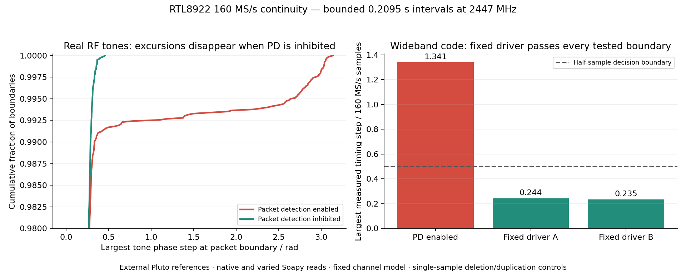

# 160 MS/s sample continuity: packet-detection control and bounded pass

**The corrected PAXI profile passes the bounded Pluto-reference continuity
check at 160 MS/s / 2447 MHz.** A one-second capture contains 160,000,000 complex
samples; the scored central 0.9997952 seconds has no detected timing gaps at
39,055 native packet boundaries, 78,111 Soapy read boundaries, 39,054 interior
controls, or 977 actual source-ring boundaries. Every injected single-sample
deletion and duplication is detected at all 117,165 distinct tested positions.
This qualifies that bounded interval and the tested fault controls, not
indefinite reception or every possible alteration of a noisy waveform.

## Cause and intervention

The Wi-Fi packet detector remained active while the PAXI experiment held WCPU
and stopped host tracking work. Its receive processing can change the phase
and timing of the diagnostic I/Q **before** the LA ring/PCIe transport. Thus a
clean source-ring guard and host sequence count did not establish waveform
continuity. The exact internal correction stage is not decoded; the controlled
intervention establishes the packet-detection-dependent behavior.

The intervention uses the pinned driver's own `rtw8922a_bb_reset_en()` fields:

| Field | BB-relative address | RTL8922 physical address | Setting |
| --- | --- | --- | --- |
| `R_RXCCA_BE1 / B_RXCCA_BE1_DIS` | `0x0520`, bit 0 | `0x20520` | 1 |
| `R_PD_CTRL / B_PD_HIT_DIS` | `0x0c3c`, bit 9 | `0x20c3c` | 1 |

These inhibit CCK/OFDM detection without resetting the BB or changing ADC
clocks. The addresses follow the pinned RTL8922 `rtw89_phy_gen_be.cr_base` of
`0x20000`. Register names alone are not the evidence: two inhibition controls,
an enabled control, and a matched tone comparison establish the RF effect.

- With detection enabled, wideband code acquisition finds approximately
  10-sample timing excursions in the matched control. Earlier enabled captures
  also have persistent code-timeline jumps despite clean transport guards.
- Inhibiting detection removes those excursions in both repeated controls.
- In the matched dual-tone comparison, enabled detection gives 67 phase
  excursions at native packet boundaries and 67 at interior controls; inhibition
  gives zero in both sets. All 16,381 screened application boundaries also pass
  with inhibition. Re-enabling detection brings the excursions back.

The fix is in the **separate PAXI profile**, not the pinned working kernel
patch. `paxi-frozen.c` inhibits detection immediately before starting live LA
capture and again after each completed band retune, because the upstream
channel helper re-enables it. Both readbacks must succeed or the experiment
fails. The source status reports `packet_detection_quiesced=1`.
`iq_paxi_quiesce_pd` defaults to enabled; its explicit diagnostic bypass exists
for controls. Firmware hold, watchdog sequence, source-ring guards, scheduling,
packet counters and mandatory module teardown remain unchanged.



## Timing reference and decision

Pluto generates seeded, cyclic 20-Msymbol/s QPSK at 40 MS/s with root-raised-cosine
spectral shaping, plus a narrow RF pilot. The 65,536-sample transmit buffer
corresponds to 262,144 nominal receiver samples, longer than the 163,840-sample
LA ring. Two fixed-profile captures move the reference by 10 MHz; the observed
pilot movement agrees within 302 Hz. The pilot estimates carrier offset, while
the wideband code resolves timing independently of carrier phase and avoids
the short whole-cycle blind spots of a tone-only check.

The analyzer fits one clock ratio and one fixed, 257-tap channel relative to the
known transmitted code. It cannot learn a separate waveform or channel per
packet. Each side of each tested boundary has its own complex gain and timing
estimate over 16,384 samples; received I/Q is not filtered across that boundary.
The edge margins are explicit in each report. Carrier phase and gain changes
are nuisance parameters, rather than evidence of a sample deletion.

A pass requires a timing step below half a sample, a resolved global code
timeline, sufficient matched-code significance against four wrong-code lags
in the **same** window, and successful fault controls. One-sample controls must
both cross the decision threshold and add the expected timing displacement
within 0.1 sample. The clock/channel models remain frozen during injection.
Every boundary is tested; this is not a sample of favorable buffer joins.

The initial coded-analysis amplitude screen incorrectly assumed approximately
constant receive gain. It rejected some clear low-gain intervals even though
their timing was resolved. Those rejected reports are retained as
`*-gain-screen-v1.json`. The final check compares code significance with
wrong-code projections per window; both short fixed-profile captures have a
minimum significance over 21 times the null RMS, against the required 6.
Independent noise-only and actual deleted/duplicated-sample tests guard against
turning that correction into a permissive pass.

## Results

| Test | Scored interval | Native / application boundaries | Maximum application timing step | Outcome |
| --- | ---: | ---: | ---: | --- |
| Packet detection enabled control | 0.2095104 s | 8184 / 16368 | 1.3413 samples | Fails; global timing excursions reach about 10.43 samples |
| Corrected profile, reference A | 0.2095104 s | 8184 / 16368 | 0.2435 samples | Pass |
| Corrected profile, reference B, +10 MHz | 0.2095104 s | 8184 / 16368 | 0.2346 samples | Pass |
| Corrected profile, one-second capture | 0.9997952 s | 39055 / 78111 | 0.2861 samples | Pass |

The one-second run detects **117,165/117,165 single deletions** and
**117,165/117,165 single duplications**, including the actual received noise at
each test position. It also rejects all 128 controls for each of: a 2048-sample
deletion, a 4096-sample deletion/duplication, and a 163840-sample ring-sized
deletion/duplication. Two short independent runs pass the same controls.
All fresh captures pass transport/source guards and restoration checks.

Raw received I/Q and generated reference/model arrays remain ignored local
artifacts. Reports retain their hashes, binary/source provenance, loaded driver
srcversion, source guards, settings, analyzed interval, thresholds, fault counts
and worst boundaries. Tone-only fields left in early coded capture metadata are
explicitly corrected; `coded_reference` and the transmitted-wave hash describe
the actual code. No raw capture, firmware or build artifact is committed.

## Reproduction and deployment

- [One-second continuity report](../output/rtl8922-coded-fixed-long-analysis-20261015.json)
- [Independent reference A](../output/rtl8922-coded-fixed-a-analysis-20261015.json)
- [Independent reference B](../output/rtl8922-coded-fixed-b-analysis-20261015.json)
- [Enabled-detector negative control](../output/rtl8922-coded-pd-on-analysis-20261015.json)
- [Tone intervention control](../output/rtl8922-tone-pd-control-analysis-20261015.json)
- [Control-session restoration](../output/rtl8922-coded-pd-control-session-20261015.json)
- [Final capture restoration](../output/rtl8922-coded-fixed-long-session-20261015.json)
- [Deployment and independent readbacks](../output/rtl8922-continuity-deployment-20261015.json)

Offline reanalysis, with the local ignored capture available:

```sh
OPENBLAS_NUM_THREADS=1 uv run --with numpy==2.2.6 --with scipy==1.15.3 \
  python research/streaming/analyze-coded-continuity.py \
  output/rtl8922-phase-coded-fixed-long-20261015.json \
  --output output/continuity-reanalysis.json
```

`paxi-phase-capture.py --run-rf-test --soapy-2447 --coded-wideband` is explicitly
manual and requires `run-receiver.sh`, an unused card, an output path and a
bounded gain. `--samples 160000000` records the one-second case. The wrapper
refuses an occupied card. Fresh Pluto settings, a five-second TX deadline,
`finally` muting/restoration and module teardown are mandatory. These tools
must never become automatic RF/CI tests.

The corrected modules were built in a fresh pinned checkout, tested there, then
placed in `vendor/rtw89-paxi-wide` only with the card released and modules
unloaded. The previous profile is preserved under the ignored
`vendor/rtw89-paxi-pre-phase-20261015`. `driver/prepare-default.sh` reconstructs
the corrected profile. The existing demo is restored at 2447 MHz / 160 MS/s,
using the tested modules, with Pluto TX off and saved settings unchanged.

Five independent coded controls, five phase controls, the compiled BB helper
readback/failure test, the complete 33-test receiver suite, kernel build and
research dependency doctor pass. Retunes still create explicit gaps. Full-band
RF fidelity, other RF centers' sample-level qualification, cancelling paired
edits within an analysis window, periodic-code ambiguities beyond the guarded
ring-loss bound, and indefinite continuity are not established by this trial.
