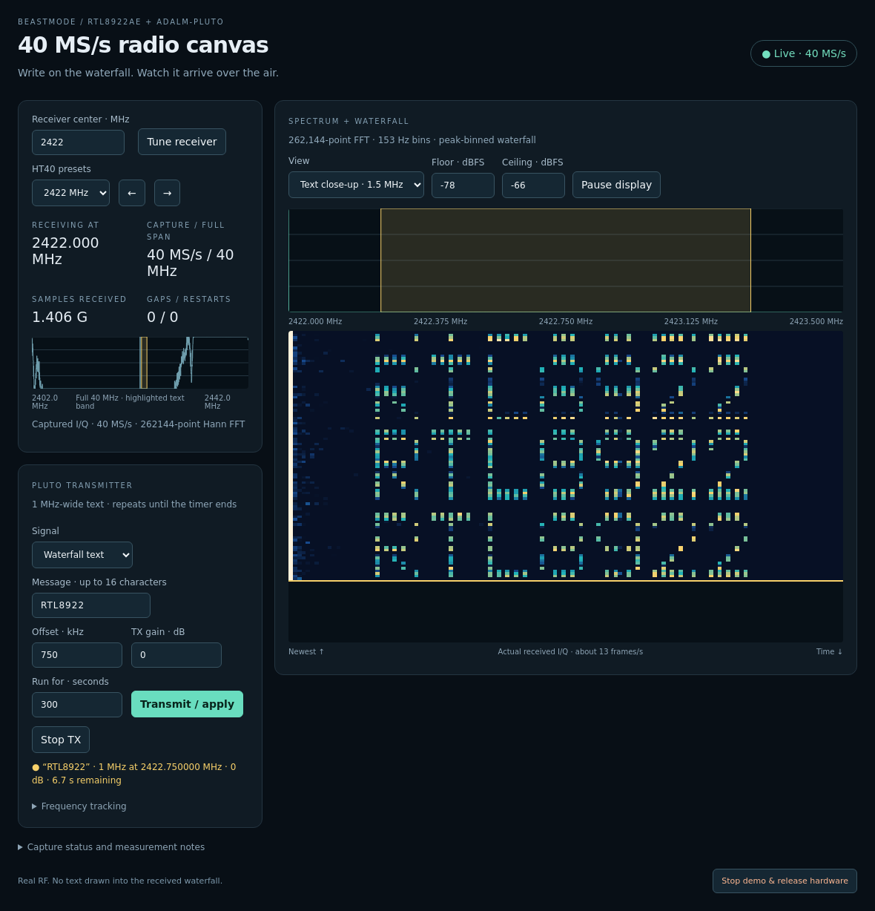

# 40 MS/s waterfall-text demo

For setup and troubleshooting, see [getting started](getting-started.md).
The browser labels the external **Pluto** transmitter explicitly, waits for live
samples before enabling tune/start controls, preserves command errors between
frame updates, and shows that pausing the display leaves reception running.
These UI refinements were checked with mocked API responses, without RF access;
the hardware measurements below retain their original dates and scope.

The live demo captures experimental 40 MS/s CF32 at 2422 MHz and offers
receiver centers from 2422 to 2462 MHz. Pluto sends `RTL8922` on a nominal
1 MHz canvas centered at +750 kHz. The browser provides a 40 MHz overview,
a 1.5 MHz close-up, editable text, tone mode, gain/offset controls and a
5–300-second transmission timer.

The screenshot is the real received spectrum, not a synthetic overlay. It
shows a bounded validation transmission; its countdown is historical.

## Implementation

Each illuminated font pixel gets a narrow carrier. Deterministic phase search
reduces crest factor; all rows use a common peak scale. The seven font rows
are sent bottom first, with a blank row separating repeats, so text appears
upright in a newest-at-top waterfall. Pluto changes its small 16,384-sample
cyclic buffer approximately every 0.3 seconds, gating TX during replacement.
The nominal canvas is 1 MHz; spectral skirts and hardware leakage are not
claimed to remain inside an ideal rectangular mask.

A 262,144-point Hann FFT resolves 153 Hz at 40 MS/s. Peak pooling preserves
narrow carriers in the browser. The receive loop continuously drains CF32;
a separate, bounded publisher replaces old pending display snapshots when
the display falls behind. It never queues an unlimited recording. Display
skips and capture errors are distinct counters.

The working kernel driver is unchanged. The service now starts this checkout
with the original pinned modules in `rtl8922-iq-research/la-driver`. A private
`SOAPY_SDR_ROOT` plus the local build plugin path prevents an installed older
Soapy module from taking precedence. The former 20 MS/s service launcher
remains available in the original checkout.

## Verification on 2026-10-12

- Eight offline tests passed: RF carrier placement and glyph orientation,
  font validation, row progression, follow tuning, timer/stale-RX shutdown,
  failure restoration, refusal to interrupt another transmitter and tone mode.
- Real reference tones at +750 and −750 kHz moved **1,499,938.965 Hz** for a
  commanded 1.5 MHz shift. Their median peak/noise-floor differences were
  **33.39 and 32.59 dB**. The approximately −10 kHz oscillator offset remains.
- All eight text row states were observed. The five-second timer stopped TX,
  and fresh independent IIO reads matched all saved Pluto settings, including
  TX powerdown. Out-of-range tuning was rejected.
- The bounded RF check added **471,859,200 samples**, with **zero** reported
  capture errors or receiver restarts.
- A deliberate **two-second display-process suspension**, with Pluto off,
  added **103,809,024 samples** across the observation interval. It skipped
  **24 display snapshots** and added **zero** capture errors or restarts.
- Chromium rendered the received text with no JavaScript errors. The 680-pixel
  layout had no horizontal overflow; full-span/close-up switching, pause/resume
  and starting text through the UI all passed.

An earlier synchronous 262,144-point display experiment stalled the receive
path and hit its restart limit. Its failure report is preserved; the bounded
publisher fixes that back-pressure path. This does **not** qualify indefinite
drop-free reception or establish sample-level continuity. Existing
[throughput qualification limits](streaming-throughput.md) still apply.

Evidence: [RF/timer/restoration](../output/rtl8922-demo40-live-check.json),
[display stall](../output/rtl8922-demo40-backpressure-check.json),
[earlier display failure](../output/rtl8922-demo40-blocking-display-failure.json),
[browser controls](../output/rtl8922-demo40-browser-check.json),
and [deployment snapshot](../output/rtl8922-demo40-deployment.json).

## Forwarded browser ports

The initial HTTP Host check accepted only port 8732, so the in-app browser's
`localhost:52862` forwarding returned a 403 with `{}` instead of the page.
The server now accepts valid ports on localhost, 127.0.0.1 and [::1], while
still rejecting other hostnames and mismatched command origins. The browser
page and control validation passed through a real local forwarding proxy,
with no JavaScript errors. Eleven offline tests pass, including the three
forwarding/origin regressions. See the
[forwarding check](../output/rtl8922-demo40-forwarding-check.json).

The session ended with the demo shut down at the user's request. Pluto TX was
independently verified off, all receiver modules were unloaded, the card was
released and temporary files were removed. See the
[shutdown report](../output/rtl8922-demo40-user-shutdown.json).
