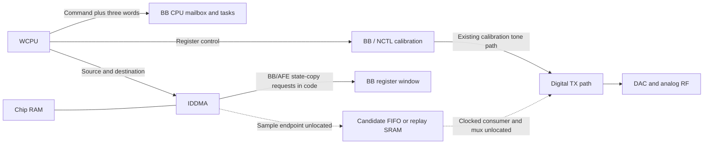

# WCPU DMA and BB control flow — 2026-10-12

The WCPU DMA route is worth pursuing. Its ROM routine programs a source and a
destination without a RAM-only destination restriction. The supplied firmware
also contains paired helpers that request bulk DMA into and out of a BB/AFE
window. Neither establishes a DAC sample input. A FIFO with suitable flow
control, or writable memory with a clocked replay reader, remains the missing
connection.

This pass was entirely offline. The card, Pluto, working driver and stopped
demo were untouched. The [inspector](../research/firmware/inspect_dma_mailbox.py)
executes selected instructions from the pinned firmware and freshly reproduced
WCPU ROM in Unicorn. Its [report](../output/rtl8922-dma-mailbox-analysis.json)
records hashes, short excerpts, register programs and explicit emulator stubs.
The function-pointer snapshot is historical. Emulated MMIO is ordinary memory;
no DMA bus transfer, interrupt delivery, DAC behavior or RF output is simulated.

## DMA can be directed at addresses supplied by firmware

Historical slot `0x2020206c` resolves to WCPU ROM `0x20008904`. Executing this
routine, including its actual channel-ready and register read/write helpers,
recovers the following interface:

| Argument | Observed behavior |
|---|---|
| `a0` | Channel 0 through 5; larger unsigned values rejected |
| `a1` | Source address |
| `a2` | Destination address |
| `a3` | Length field, truncated to 18 bits |
| `a4` | Zero sets control bit 28; nonzero leaves it clear |
| `a5` | Nonzero sets control bit 29 |

For each source and destination, values at least `0x30000000` are masked with
`0x1fffffff`; smaller values are unchanged. For example, CPU-view `0xb8637608`
becomes `0x18637608`. This is the routine's explicit normalization rule, not a
universal translation between all CPU address spaces.

The routine writes four values through the plain store helper at `0x20009454`:

| WCPU address | Value |
|---|---|
| `0xb8008000 + 16*channel` | Normalized source |
| `0xb8008004 + 16*channel` | Normalized destination |
| `0xb8008008 + 16*channel` | Length and bits 28/29 |
| Same control register | Previous control value with bit 31 set |

The global register window `0x18008000` also appears in the working driver's
existing IDDMA receive path. This differs from the packet AXI engine at
`0x18006000`; its packet TX descriptors do not identify a DAC endpoint.

Thirty offline cases cover all six channels and four flag combinations, an
invalid channel, a busy channel, critical-section calls, address normalization,
length truncation and an unaligned source with a register-like destination.
The latter demonstrates the absence of a software filter; no transfer to that
destination occurred. The routine even programs zero length and truncates
`0x40000` to zero. These are raw interface properties, not proposed valid tests.

The hardware meanings of bits 28/29, fixed versus incrementing addressing,
peripheral request support and arbitrary-address bus reachability remain
unresolved. The start routine contains no explicit DAC request selector. A
successful software return means it programmed the engine, not that a valid
sample stream reached any destination. The ROM wait routine at `0x20008a26`
polls control bit 31 and channel status without a software deadline.

## The firmware already requests BB/AFE bulk copies

There is a more concrete clue than the general destination argument:

| Function in the WCPU image | DMA request |
|---|---|
| `0x2011af04` | `0xb862c000` to caller-supplied buffer, length `0x250` |
| `0x2011af70` | Caller-supplied buffer to `0xb862c000`, length `0x250` |

The entire pointer-initialization function at `0x201464d8` was executed offline.
It sets slot `0x2020d0a0` to wrapper `0x20146440`, which delegates through
historical slot `0x2020206c` to the same ROM DMA routine. Slot `0x2020d09c` points
to `0x2014644a`, which delegates to the ROM completion wait. The pointers start
as zero in the initialized-data image, so reading that data alone misses the
connection.

Executing each helper produces channel-0 DMA source/destination registers with
`0x1862c000` on the BB side, `0x250` in control, then `0x80000250`. This is a
592-byte state-copy request. Only completion is stubbed successful in these two
traces; no copying or peripheral behavior is simulated.

The supplied image includes `backup_afedig_8922d` and `restore_afedig_8922d`
error strings. Treat these as code evidence in this image; execution on our
RTL8922AE and the exact state-block contents have not been established. There
is no playback source pointer, sample count/repeat configuration or DAC reader identified
at this BB window. It must not be called waveform RAM.

A separate RAM routine at `0x20126bf2` also programs the same engine directly
for channels 0/1, using the same address masking and 18-bit length with bit 31
start. It does not expose an additional DAC-specific DMA engine.

## WCPU and BB CPU communicate through a command mailbox

The matching routines establish a concrete control protocol:

| Item | WCPU view | BB CPU view |
|---|---|---|
| Mailbox base | `0x18637600` | `0xa0017600` |
| Slot-0 header | Base + `0x00` | Base + `0x00` |
| Three argument words | Base + `0x08/0x0c/0x10` | Base + `0x08/0x0c/0x10` |
| Producer notification | Base + `0x80`, bit 0 | Receiver handles peer notification |
| Completion notification | WCPU polls status at +`0x8c`, bit 16 | BB sets +`0x84`, bit 0 |

WCPU producer `0x20111660` calls header builder `0x2011148c`, stores the three
arguments and sets the notification. The header is:

```text
0xc0000000 | ((command & 0xfff) << 18) | 3
```

BB receiver `0x100117ee` copies three words using `0x100106f4`. Interrupt handler
`0x10014c0c` receives the command through `0x1001075e` and queues it. The
`BackupRestore` task at `0x10014d5a` invokes dispatcher `0x1001280a`, which reads
the arguments, selects one of 21 table entries at `0x100249ec` and signals
completion through `0x100106da`.

Three emulated sender/receiver cases preserve all argument words and confirm
12-bit command masking. Producer initialization and old-completion handling
are stubbed; interrupt delivery is not modeled. Manually copying the payload
between the two emulator address domains verifies matching formats, not a
physical alias. Their matching register offsets and code paths support the
mailbox correspondence without implying a full BB address translation or a
BB ROM read alias.

This mailbox supplies control commands. Its three-word payload is not evidence
of a sample FIFO. The separate parser's ROM APIs remain unresolved, as described
in the [waveform-source trace](waveform-source-trace.md).

## What this means for arbitrary I/Q

The established control flow branches. The WCPU can use the BB mailbox, and the
traced DPK routine also writes BB/NCTL registers directly. A BB CPU instruction
loop is not established as the source of every DAC sample.



There are two useful endpoint candidates to seek:

1. A bus-visible sample FIFO that accepts DMA writes with backpressure and
   suitable fixed-address semantics.
2. Writable sample memory with a hardware reader that controls sample rate,
   length/repeat, I/Q packing and the TX source mux. DMA could refill that memory
   independently of sample timing.

The second is a useful working hypothesis, not a discovered interface. A DAC
can have bus-visible configuration registers while receiving samples through a
separate internal stream. DMA-writing its clock or calibration registers would
change configuration rather than produce arbitrary I/Q.

The next static target remains the calibration stimulus/source selection:
trace the NCTL bandwidth operations `0x20..0x23` and IDL operations
`0x2d/0x33/0x2e` toward their data source and DAC mux. The missing evidence is a
sample writer or buffer and a clocked consumer. The paired BB/AFE DMA helpers
give a concrete transport lead once that endpoint is found; they do not justify
blind DMA writes into the BB/analog register space.

The subsequent [NCTL source analysis](nctl-source-findings.md) recovers a partial
sequencer encoding and matches all four bandwidth operations to fixed TPG
presets. It also maps the traced IDL commands to short control wrappers. The
hardware sample source and downstream DAC connection remain unresolved.

The subsequent [native debug-memory analysis](tx-debug-memory-findings.md)
checks 99 bounded offline selector/wrapper cases. The visible TX SRAM selectors
resolve to MAC packet storage; the additional selectors include CAM/table
regions, not an identified DAC sample port. It also distinguishes the BB MCU
register aperture from its still-missing local ROM.

## Reproduction and validation

Install `research/requirements.txt` and the optional
`research/firmware/requirements-rom-emulation.txt` into a local virtualenv.
Supply the pinned firmware, a local WCPU ROM window and the historical pointer
snapshot; this inspector does not acquire any of them from hardware.

```sh
python3 research/firmware/inspect_dma_mailbox.py \
  --firmware vendor/rtw89/firmware/rtw8922a_fw-4.bin \
  --rom /path/to/wcpu-rom-window.bin \
  --historical-table /path/to/table.bin \
  --output /tmp/rtl8922-dma-mailbox-analysis.json
python3 -m unittest discover -s research/firmware -p 'test_*.py'
```

All three inputs are hash-pinned, execution stays within explicit instruction
ranges, and every run has instruction/time limits. Reports cannot overwrite an
input. Raw firmware/ROM/table images stay excluded from Git.

Validation: 35 offline execution cases and 19 firmware tests passed. The report
reproduced byte for byte; Python syntax and whitespace checks passed. The
working driver patch retained its pinned SHA-256. No hardware tests ran.
